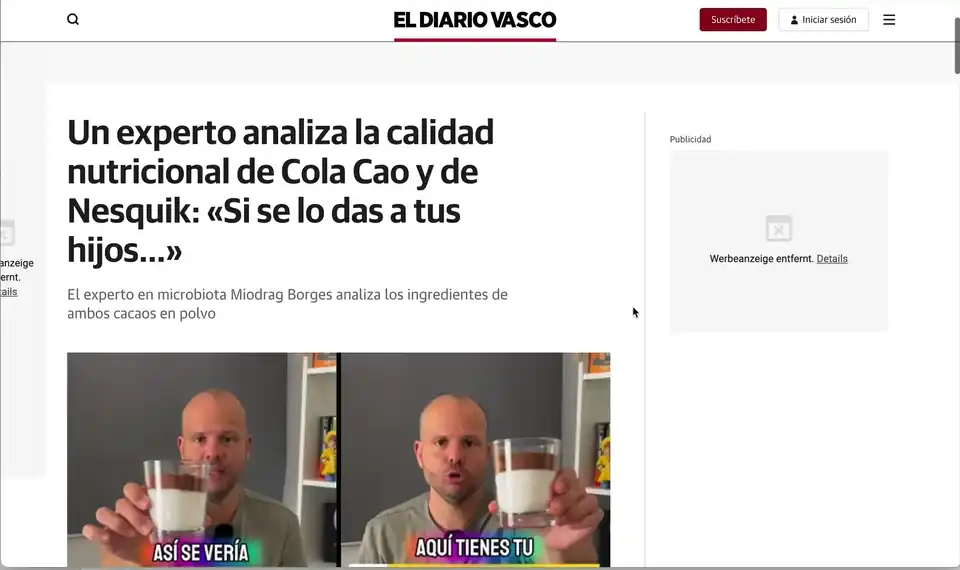
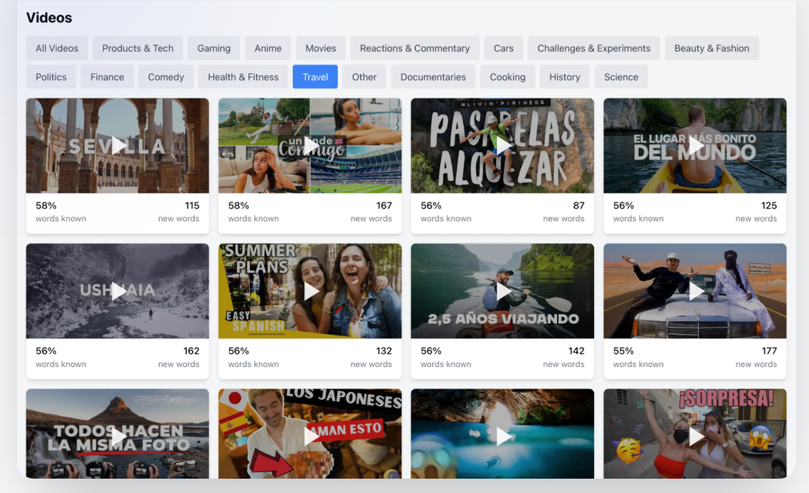
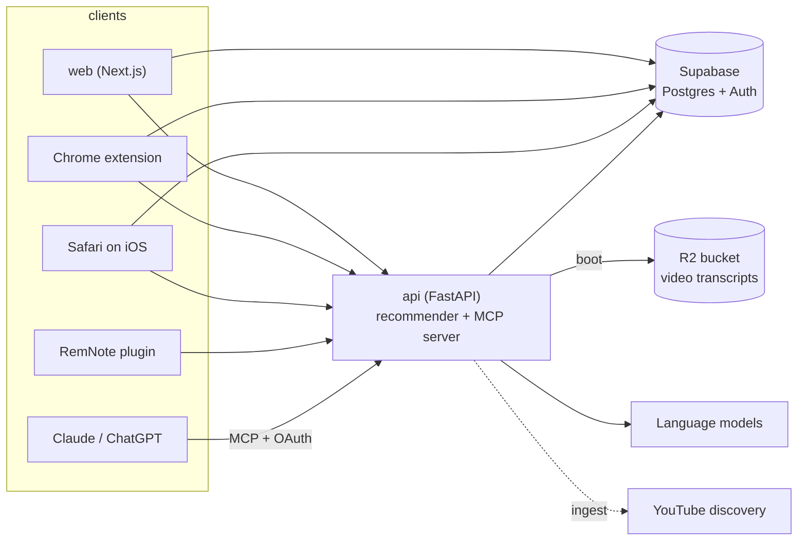

# Langfour

Langfour turns the content you already watch and read into personalized language practice.

**[langfour.com](https://www.langfour.com)** · [Open the app](https://app.langfour.com)

Its browser extension translates unfamiliar words in place on YouTube, Netflix, Prime Video and any article page, and saves them to your vocabulary. The web app turns that vocabulary into practice and recommends videos you can mostly understand. Your flashcards can live in RemNote, and Claude or ChatGPT can use what you know to talk and teach at your level.

https://github.com/user-attachments/assets/21c05a8b-ca9c-4cf9-b0f7-586e7f61d96e

[](https://github.com/victorfriedrich/langfour/actions/workflows/extension-ci.yml)

**Contents**

- [Why Langfour?](#why-langfour)
- [What it does](#what-it-does)
- [How it works](#how-it-works)
- [Design decisions](#design-decisions)
- [Running it locally](#running-it-locally)
- [Project status](#project-status)
- [License](#license)

Deeper reading: **[Architecture](docs/architecture.md)** · **[Configuration](docs/configuration.md)** · **[Database schema](apps/api/sql/supabase_schema.md)**

## Why Langfour?

Learners choose between native content that is too hard and graded material that isn't interesting. Once you know about 95% of the words, you can follow a video without stopping (van Zeeland & Schmitt, 2013). Langfour is built around that number: it shows how much of each video you already understand and finds the words that would raise it most.

Those are usually not the most common words of the language but the ones a channel keeps using. 30 words from a channel you watch help as much as hundreds of everyday words.

## What it does

**Reader Mode** (`Cmd/Ctrl + Shift + Y`) rebuilds the current article as a clean page, highlights every word not yet in your vocabulary, and translates a word on click or a passage in context. **Subtitles** work the same way inside YouTube, Netflix and Prime Video: unfamiliar words stand out, hovering pauses playback and shows a translation, and words save without leaving the video.



**Videos** covers about 30,000 YouTube videos so far, ranked by how much of each one you already understand, combined with how good and how engaging it is. You can follow favourite channels and discover new ones at your level.



**Library** keeps the articles, texts and song lyrics you save, in folders, with their key words picked out.

**Practice** is a spaced-repetition session over the words due today. Existing decks come in through Anki import.

**Grammar** follows a Spanish curriculum from A1 to B2, tracks which concepts you have learned, and flags the ones worth revisiting.

**AI chat connector** links your vocabulary and grammar progress to Claude or ChatGPT. The assistant writes at your level, works in the words you are learning, gives you lessons, and records how you did.

**RemNote plugin** turns saved words into RemNote flashcards and reports your reviews back to Langfour.

**Safari on iOS** brings Reader Mode and tappable YouTube captions to the iPhone.

## How it works



Supabase owns user state, and the web app and extensions reach it directly under row-level security. The API owns everything that needs the whole video library or a language model, and it is the door for RemNote and AI chat. A background pipeline decides which YouTube videos are worth transcribing and adds them to the library.

Full walkthrough in **[docs/architecture.md](docs/architecture.md)**.

## Design decisions

**Channels are found through Common Crawl.** The crawl's URL index is sorted, so the pipeline binary-searches it with HTTP range requests and downloads only the blocks that list YouTube channels. About 40 monthly crawls gave over 700,000 channel IDs without touching the YouTube API. → [details](docs/architecture.md#finding-videos-worth-transcribing)

**Popularity and quality are scored separately, then multiplied.** Engagement from the YouTube API (likes and comments per view, views per subscriber) shows whether people watch a channel. A language model judges whether it is worth a learner's time and whether anyone would watch it for fun. Each signal is ranked as a percentile and they are combined with a weighted geometric mean, so popular junk sinks on worth and worthy lectures sink on appeal.

**Model judgments are stored as probabilities.** Most judgment calls go to Jev, a model that answers fixed multiple-choice questions with a probability for each answer: a transcript's quality and grammar level, each video's topic, a channel's worth and appeal, which words of a text matter most, and which new words a learner can probably guess. The probabilities are saved, so thresholds can be changed without asking again. Thumbnails go to a vision model instead, since clickbait is mostly in the picture.

**The AI chat connector serves data and the user's assistant does the thinking.** The MCP server returns vocabulary, grammar progress and the rubrics needed to judge answers consistently, and records the results the assistant reports. It runs no model of its own.

**Recommendations count words heard.** Each language is a sparse matrix of transcripts by dictionary words, and ranking every video for a user is one matrix-vector product. Each cell holds how often a word is said, so a video's score is the share of what you would hear that you already know. Cells used to be 1 or 0, which counted a word said once the same as one said fifty times and made long videos look harder than they are. → [details](docs/architecture.md#comprehension-ranked-recommendations)

**Vocabulary is tracked as dictionary roots, and the dictionary grows itself.** "hablo", "hablas" and "hablé" count as one known word. A word the dictionary doesn't have yet is checked by a model once, reduced to its root, given its inflections and saved, so every later text and user finds it in the cache. → [details](docs/architecture.md#from-text-to-dictionary-ids)

## Running it locally

Requires Node.js 20+, Python 3.12 with `venv`, a [Supabase](https://supabase.com) project and an [OpenRouter](https://openrouter.ai) key. `ffmpeg` is only needed to transcribe videos that have no subtitles.

```bash
git clone git@github.com:victorfriedrich/langfour.git
cd langfour
npm install
npm run api:install

cp apps/web/.env.sample       apps/web/.env
cp apps/extension/.env.sample apps/extension/.env
cp apps/api/.env.sample       apps/api/.env

npm run dev          # web on :3000, API on :8000
npm run api:test     # API tests
npm run build:ext    # writes apps/extension/dist, load it unpacked
```

Each app gets its own environment file because everything in the web and extension files reaches users, and only the API file may hold a secret. Supabase and OpenRouter are all you need to run the app. Every variable and service, and where to find it, is in **[docs/configuration.md](docs/configuration.md)**.

> **On the name.** The product is Langfour everywhere it is user-visible, but internal identifiers keep an earlier `langfive` prefix. Renaming them means changing the deployed environment in lockstep, so they are left alone deliberately.

## Project status

A working prototype I use daily: deployed and usable, not a polished product.

- **Chrome extension:** distributed as a zip rather than through the Chrome Web Store.
- **Safari on iOS:** only tested locally so far.
- **RemNote plugin:** only works locally so far. It still needs to be published as an unlisted plugin.
- **Languages:** built around Spanish. German, Italian and French are supported in code, with much smaller video libraries.
- **Setup:** the database schema lives in the hosted Supabase project and is not yet a complete set of migrations, so a from-scratch install needs it applied by hand. [`supabase_schema.md`](apps/api/sql/supabase_schema.md) lists what that means.
- **Tests:** most of them cover the API. CI checks the extension and its YouTube selectors only.

Next steps: publish the Chrome extension on the Web Store, publish the RemNote plugin as unlisted, get Safari on iOS beyond local testing, and export the schema as migrations.

## License

MIT
