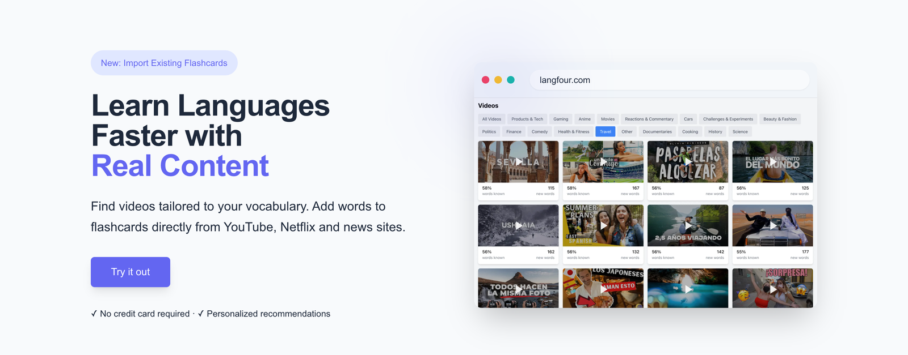
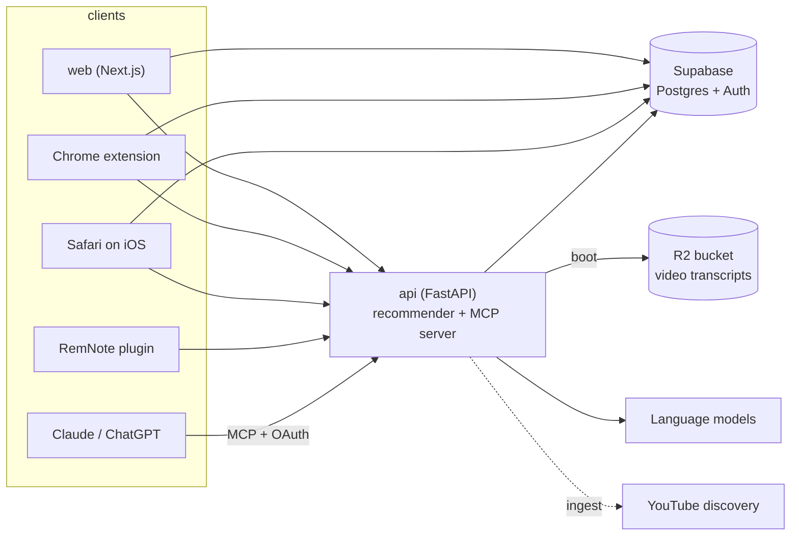

# Langfour

Langfour turns the content you already watch and read into personalized language practice.

Its browser extension translates unfamiliar words in place on YouTube, Netflix, Prime Video and any article page, and saves them to your vocabulary. The web app turns that vocabulary into practice and recommends videos you can mostly understand. Your flashcards can live in RemNote, and Claude or ChatGPT can use what you know to talk and teach at your level.



[](https://github.com/victorfriedrich/langfour/actions/workflows/extension-ci.yml)

**Contents**

- [Why Langfour?](#why-langfour)
- [What it does](#what-it-does)
- [How it works](#how-it-works)
- [Five decisions worth defending](#five-decisions-worth-defending)
- [Running it locally](#running-it-locally)
- [Project status](#project-status)
- [License](#license)

Deeper reading: **[Architecture](docs/architecture.md)** · **[Configuration](docs/configuration.md)** · **[Database schema](apps/api/sql/supabase_schema.md)**

## Why Langfour?

Learners are stuck choosing between authentic content that is too hard and graded material that is not interesting. Research on extensive reading puts the sweet spot around 95% known words, but nothing tells you which video that is.

Langfour tracks your vocabulary as dictionary root forms rather than raw strings, marks and translates unfamiliar words while you browse, finds videos at your level, and carries what you save into practice.

## What it does

**Reader Mode** (`Cmd/Ctrl + Shift + Y`) rebuilds the current article as a clean page, highlights every word not yet in your vocabulary, and translates a word on click or a passage in context. **Subtitles** work the same way inside YouTube, Netflix and Prime Video: unfamiliar words stand out, hovering pauses playback and shows a translation, and words save without leaving the video.


**Videos** covers about 30,000 YouTube videos so far, ranked by how much of each one you already understand, combined with how good and how engaging it is. You can follow favourite channels and discover new ones at your level.


**Library** keeps the articles, texts and song lyrics you save, in folders, with their key words picked out.

**Practice** is a spaced-repetition session over the words due today. Existing decks come in through Anki import.

**Grammar** follows a Spanish curriculum from A1 to B2, tracks which concepts you have learned, and flags the ones worth revisiting.

**AI chat connector** links your vocabulary and grammar progress to Claude or ChatGPT. The assistant writes at your level, works in the words you are learning, gives you lessons, and records how you did.

**RemNote plugin** turns saved words into RemNote flashcards and reports your reviews back to Langfour.

**Safari on iOS** brings Reader Mode and tappable YouTube captions to the iPhone.

## How it works



Supabase owns user state, and the web app and extensions reach it directly under row-level security. The API owns everything that needs the whole video library or a language model, and it is the door for RemNote and AI chat. A background pipeline decides which YouTube videos are worth transcribing and adds them to the library.

Full walkthrough in **[docs/architecture.md](docs/architecture.md)**.

## Five decisions worth defending

**Recommendations are one matrix-vector product.** Each language is a sparse matrix with a row per transcript and a column per dictionary root, so scoring every video for a user is a single multiplication followed by a division. → [details](docs/architecture.md#comprehension-ranked-recommendations)

**The backend refuses to boot with the wrong database key.** With row-level security on, the wrong key does not raise an error: queries return nothing, and every word silently becomes unknown. That shipped once, so the API now checks its own key at startup and exits if it is wrong. → [details](docs/architecture.md#auth-and-the-two-supabase-keys)

**Auth denies by default.** It is a middleware rather than a per-route check, because the per-route version had left most endpoints open, including the ones that spend model credits. A new route is protected unless someone deliberately adds it to a short public list. → [details](docs/architecture.md#auth-and-the-two-supabase-keys)

**The transcripts stream into the container.** Gigabytes of transcripts belong in neither git nor an image, so they ship as one compressed archive per language and unpack at boot with very little memory. → [details](docs/architecture.md#the-transcript-corpus)

**The discovery pipeline spends late.** Candidate channels come from free public data rather than the quota-metered YouTube API, every stage can resume where it stopped, and the stages that cost real money run only on channels that cleared every cheaper check. → [details](docs/architecture.md#finding-videos-worth-transcribing)

## Running it locally

Requires Node.js 20+, Python 3.12 with `venv`, a [Supabase](https://supabase.com) project and an [OpenRouter](https://openrouter.ai) key. `ffmpeg` is only needed to transcribe videos that have no subtitles.

```bash
git clone git@github.com:victorfriedrich/langfour.git
cd langfour
npm install
npm run api:install

cp apps/web/.env.sample       apps/web/.env
cp apps/extension/.env.sample apps/extension/.env
cp apps/api/.env.sample       apps/api/.env

npm run dev          # web on :3000, API on :8000
npm run api:test     # API tests
npm run build:ext    # writes apps/extension/dist, load it unpacked
```

Each app gets its own environment file because everything in the web and extension files reaches users, and only the API file may hold a secret. Supabase and OpenRouter are all you need to run the app. Every variable and service, and where to find it, is in **[docs/configuration.md](docs/configuration.md)**.

> **On the name.** The product is Langfour everywhere it is user-visible, but internal identifiers keep an earlier `langfive` prefix. Renaming them means changing the deployed environment in lockstep, so they are left alone deliberately.

## Project status

A working prototype I use daily: deployed and usable, not a polished product.

- **Chrome extension:** distributed as a zip rather than through the Chrome Web Store.
- **Safari on iOS:** only tested locally so far.
- **RemNote plugin:** only works locally so far. It still needs to be published as an unlisted plugin.
- **Languages:** built around Spanish. German, Italian and French are supported in code, with much smaller video libraries.
- **Setup:** the database schema lives in the hosted Supabase project and is not yet a complete set of migrations, so a from-scratch install needs it applied by hand. [`supabase_schema.md`](apps/api/sql/supabase_schema.md) lists what that means.
- **Tests:** most of them cover the API. CI checks the extension and its YouTube selectors only.

Next steps: publish the Chrome extension on the Web Store, publish the RemNote plugin as unlisted, get Safari on iOS beyond local testing, and export the schema as migrations.

## License

MIT
