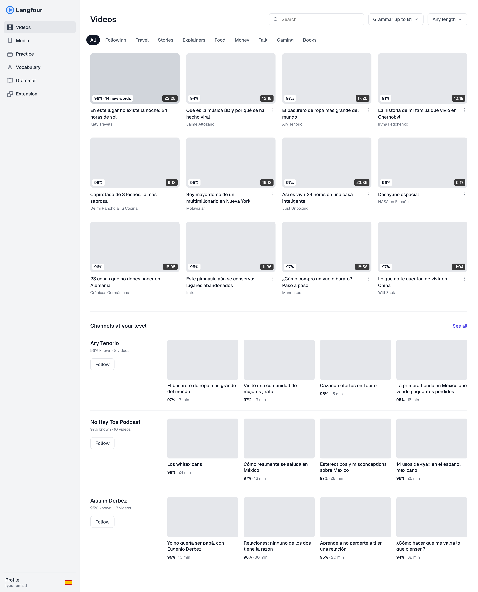
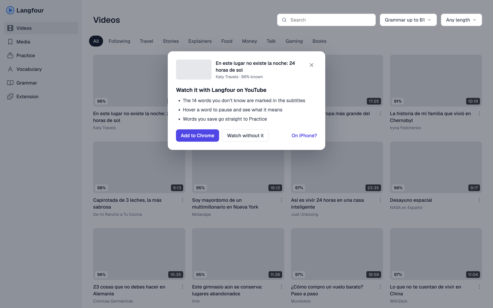
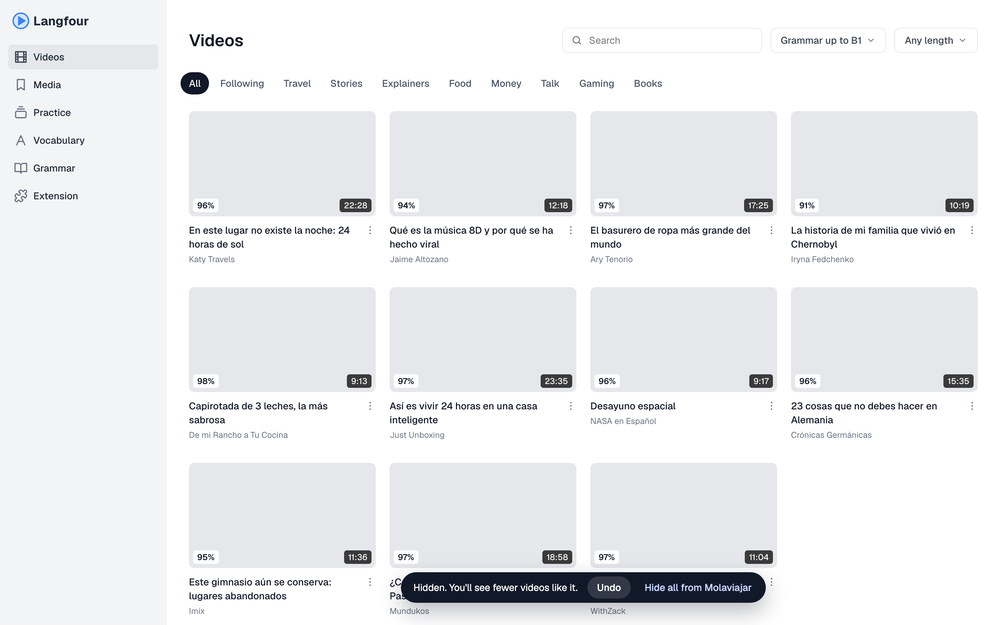
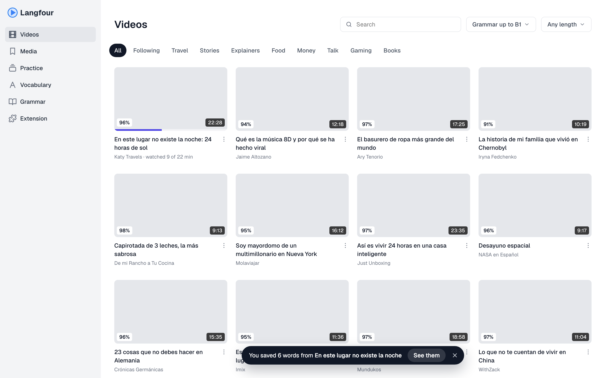
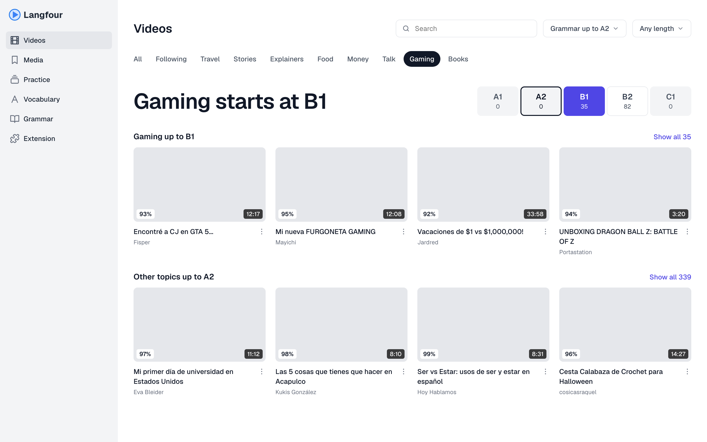

# Home page redesign

Status as of 2026-11-03: plan and mockups, nothing built. The core loop: open home, pick a video,
watch it on YouTube with the extension, words get marked, more videos come within reach, come back.

Thumbnails are grey on purpose, so the repo holds no YouTube images. Titles and channel names are
real catalog data. Mockup sources are in `home-redesign/source/` (`.dc.html`, a design canvas
format that needs its own runtime): read them as a spec, don't port the format.

## 1. Home

A grid of 12 videos with the channel name under the title and no views, then Channels at your
level. Hovering a video expands its badge from `96%` to `96% · 14 new words` (shown on the first
card). `newWords` already comes from `recommend_videos`; touch screens need another way to see it.

- **Grammar filter:** `video_scores.grammar` is stored but not used yet (A1 to C1 as 1, 3, 5, 7, 9).
- **Topics:** `video_looks.genre` covers only 4,248 Spanish videos, and its values (howto, review…)
  don't match the chips (Travel, Food…), so topics need a mapping and more coverage.
- **Channels at your level:** `channels.py` already computes `understood` and `best` per channel.

## 2. First click without the extension

Explains once what the extension adds, offers Add to Chrome, and still lets you watch.
`useExtensionStatus` already detects the extension. Where "On iPhone?" leads is still open.

## 3. Not interested

The card leaves at once, with Undo and Hide all from the channel in a pill. The current grid has no
such action, so this needs storage and a recommender exclusion. "You'll see fewer videos like it"
should only ship once the recommender acts on it.

## 4. Back from YouTube

The card shows how far you got, and a pill says how many words you saved, with See them going to
Practice. `watch_events.share` gives the progress. `word_events` records saves (`kind` saved); check
that its `context` names the video.

## 5. Filters that leave nothing

Says where the topic starts, shows how many videos each level has, and shows the nearest videos
straight away, next to easy videos from other topics.

Measured 2026-11-03, cutting the grammar score halfway between levels:

| | A1 | A2 | B1 | B2 | C1 |
|---|---|---|---|---|---|
| Clean Spanish videos | 27 | 312 | 5,019 | 9,130 | 44 |
| Gaming (labelled videos only) | 0 | 0 | 35 | 82 | 0 |

Only about 2% of videos are A2 or below, so A2 learners will reach this screen with most topics.

## Placeholders

The % values, new-word counts, "6 words", "watched 9 of 22 min" and the "8 videos" style counts on
channel rows are placeholders. The topic chips are not final.

## Decided against

- Pasting a YouTube link to score it.
- Continue watching (people often stop a video because they lost interest) and a single Up next.
- Too hard / Too easy in the card menu: you can't tell from the home screen.
- Clicking a small % to see key words before watching.
