# Langfour on YouTube

Status as of 2026-11-01: plan, nothing built; revised after the UX audit of this PR. People learn a language on YouTube by watching
hours of videos they can mostly follow, and they stay for channels they love. This plan makes
Langfour good at both: it knows which videos you can follow, learns which channels you love,
and stays out of the way while you watch. Mockups and charts are in `docs/plans/youtube-plan/`.

| # | Feature | Group | Size |
|---|---|---|---|
| 1 | [Known words that stay honest](#1-known-words-that-stay-honest) | Fix the basics | M |
| 2 | [A watch signal that includes the YouTube app](#2-a-watch-signal-that-includes-the-youtube-app) | Fix the basics | M |
| 3 | [Fit badges on every thumbnail](#3-fit-badges-on-every-thumbnail) | Find | M |
| 4 | [Favourite channels](#4-favourite-channels) | Find | L |
| 5 | [Your feed: a queue per learner](#5-your-feed-a-queue-per-learner) | Find | L |
| 6 | [Steer YouTube's own recommendations](#6-steer-youtubes-own-recommendations) | Find | M |
| 7 | [A watch panel built for flow](#7-a-watch-panel-built-for-flow) | Watch and keep | M |
| 8 | [Core words for a channel or a series](#8-core-words-for-a-channel-or-a-series) | Watch and keep | M |
| – | [Later](#later): index ahead of demand, moment cards, a video graph | | |

## 0. What the numbers say

Measured on every Spanish transcript in `apps/api/data/processed/es` with at least 300 words:
10,908 videos from 1,346 channels. The processed JSON stores every token with its word id, so
nothing had to be re-ingested.

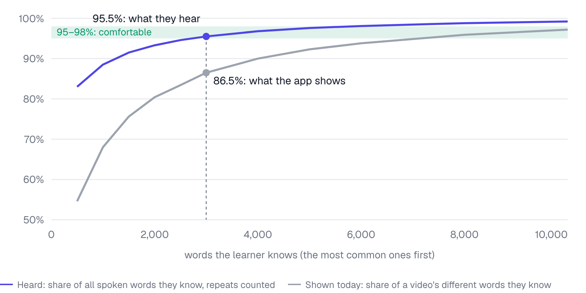

**How to read it.** Picture a set of learners: one knows the 500 most common Spanish words, the
next the 1,000 most common, and so on up to 10,000 (the horizontal axis). For each learner, go
through every video and ask two questions:

- **Grey, shown today:** of the *different* words in this video, what share do they know? This is
  the "% understood" the app shows. The recommender's document-term matrix stores 1 for "word
  appears" (`recommender.py`, `D[i, wid] = 1`), so `que` said 80 times counts once.
- **Blue, heard:** of all the words *spoken*, counting every repeat, what share do they know? This
  is what the learner experiences.

Each line is the median over all 10,908 videos. At 3,000 words the app says 86.5%, but the
learner knows 95.5% of what they hear, which is enough to follow most videos. The gap is widest
for beginners, the people who most need to hear "you can watch this".

| Words known | App shows | Heard | Videos you can follow (95% heard) | Videos the app puts at 95% |
|---:|---:|---:|---:|---:|
| 1,000 | 68.0% | 88.5% | 0.5% | 0.0% |
| 2,000 | 80.4% | 93.3% | 23.2% | 0.2% |
| 3,000 | 86.5% | 95.5% | 59.3% | 1.9% |
| 4,000 | 90.0% | 96.8% | 79.2% | 8.1% |
| 5,000 | 92.3% | 97.6% | 89.1% | 19.5% |
| 8,000 | 95.9% | 98.8% | 98.3% | 64.9% |

`recommend_videos` then sorts by the grey number, highest first. For a 3,000-word learner, the top
20 picks are 98.8% heard, have a median of 5 new words and run 4.9 minutes. The 95–98% band holds
over half the corpus for that learner, at a median of 45 new words and 12.9 minutes.

**Why every word, not distinct words.** Distinct-word coverage punishes length: a longer video
collects more rare words said once, so it scores lower even though each minute is just as easy.
At every vocabulary size, every-word coverage is the same for short and long videos:

| Learner | Rank correlation with video length: distinct / every word | Shortest quarter of videos | Longest quarter |
|---|---|---|---|
| 1,000 words | −0.58 / 0.01 | 75.0% / 88.7% | 62.2% / 88.8% |
| 3,000 words | −0.46 / −0.02 | 89.8% / 95.7% | 83.2% / 95.5% |
| 5,000 words | −0.43 / −0.04 | 94.4% / 97.7% | 90.2% / 97.5% |

That is why the app's top picks are short clips. The comprehension thresholds in the research
(95% to follow, 98% to follow comfortably) are also counted over running words. So the % becomes
every-word coverage, and "N new" stays a count of *distinct* unknown words, because that is how
many words there are to learn. One trade-off is that a single unknown word said often weighs heavily: for a 3,000-word
learner, in 5% of videos one word makes up a quarter or more of what they don't understand. That
is honest, because they miss it every time, and it is what core words (8) fix.

**With real accounts.** Real learners don't know exactly the top N words, so the same numbers on
the accounts with real Spanish vocabulary:

| Account | App shows | Heard | Videos at 90–95% heard |
|---|---:|---:|---:|
| A learner with 2,449 known words | 74.3% | 89.9% | 48.6% |
| A learner with 1,376 known words | 64.3% | 85.6% | 6.0% |
| A long-standing account, as stored | 62.1% | 68.3% | 0.0% |
| The same, with 45 stuck common words counted as known | 68.9% | 88.2% | 28.2% |
| The same, with every learning word counted as known | 74.6% | 90.4% | 53.0% |

The long-standing account comes out lowest despite the most words. `que`, `y`, `no`, `un`, `lo`,
`por` and 39 other top-300 words are stored as *learning*, from a flashcard import on 2025-05-26,
never reviewed. `user_known_words` leaves learning words out, so those 45 words count as unknown,
and they make up 20% of everything spoken in the corpus. Feature 1 fixes this.

Other things that hold today:

- The channel-page Bookmark button posts to `/youtube/bookmarks`; the API on `main` has no such
  route, so it spins on "Indexing Queued" forever (`youtubeBookmark.ts`, `api-service.ts`).
- A newly ingested transcript reaches recommendations only after `pack_corpus.sh`, an R2 upload
  with a read-write token, and an API restart (`corpus_sync.py`).
- The pipeline keeps 15 slots per channel; indexed channels have a median of 10 usable videos,
  and 418 of 1,346 have 3 or fewer.
- `videos_seen` holds 383 rows from 14 users, with no idea how much of each video was watched.

## 1. Known words that stay honest

*Fix the basics · M · ships alone, first*

Every number in Langfour depends on knowing which words you know. Words stuck in "learning" make
every video look harder than it is, so recommendations come out too easy and the badges discourage.
The stuck words aren't one account's problem: 15+ accounts have 20–123 of the top 500 words in
learning, never reviewed.

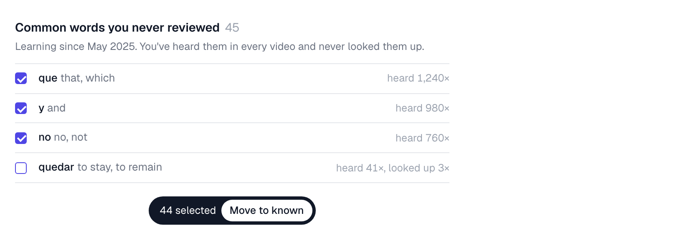

*A filter on the Vocabulary page's Learning table, with its checkboxes and the dark pill; the
extension popup links to it once. Words you've looked up stay unticked. The "heard" counts come from exposure logging: since PR 109 the extension records each
learning word once per video when its caption is on screen, and once per page in the reader.*

- **One-time cleanup:** learning words in the top 500 by corpus frequency that were never reviewed
  are offered as known.
- **Ongoing rule:** a learning word seen in 10 or more videos (`word_events` exposure rows) without
  a look-up becomes a suggestion, never an automatic change. Accepting goes through the same path
  as the MCP's `set_word_status`. "Without a look-up" needs look-ups logged, which nothing writes
  yet.
- **Onboarding:** suggest a Google account used only for Spanish now (the first lever in 6); it costs copy,
  not code.
- The same screen can show the known form-versus-root mismatches (`caía`/`caer`).

**Coverage on words heard.** The matrix stores each word's count instead of 1 (the reasons are in
section 0). It is not a one-line change, but it stays small and contained in `recommender.py`:

1. Build the matrix as `int16` with counts. Today it is `int8` with `D[i, wid] = 1`, and `+= 1`
   would overflow: one video says a word 771 times.
2. Keep a binary view next to it that shares the counts matrix's `indices` and `indptr`, with an
   `int8` array of ones. `newWords` (distinct unknown words) and `recommend_words_to_learn` (number
   of videos per word) read the view, so both keep their meaning.
3. Write `"weights": "counts"` into `document_term_matrix.npz.meta.json`, and require it in both
   `_try_load_cached_language` and the reuse check in `_create_document_term_matrix`. Today a
   binary npz with the same shape loads silently.
4. Repack and upload the corpus in the same release. The tarball carries the transcripts, so an
   old bundle would rebuild on Koyeb at boot rather than serve wrong numbers, but slowly.
5. Add a test with a repeated word to `test_recommender.py`.

Measured on the full corpus: memory for the matrix goes from 22.3 MB to about 33 MB (28.6 for the
counts, 4.8 for the view), and the two products per request take about 7 ms. With `int32` counts,
memory would be 43 MB. Row and column sums already come back as `int64`, so totals can't
overflow.

**Measure:** median heard coverage of the videos people finish. With honest data it should sit
near 95%.

## 2. A watch signal that includes the YouTube app

*Fix the basics · M · needs the learner's approval, per account*

Most watching happens in the YouTube app on a phone, where no extension runs. Google syncs a
learner's watch history across devices, so the history is the one place that also sees phone
watching.

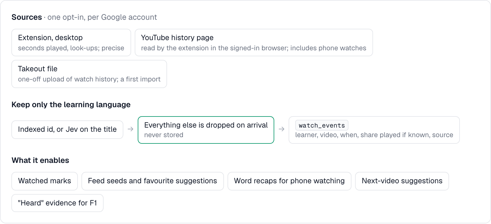

*Three ways to learn what someone watched, from most precise to most complete. Everything outside
the learning language is dropped on arrival and never stored.*

| Source | What it gives | Limits |
|---|---|---|
| Extension on desktop | Seconds actually played, look-ups | Desktop only |
| `youtube.com/feed/history`, read by the extension with the learner's own sign-in | Every watch on any device; the red progress bar gives a rough share watched | Runs only when the desktop browser is open |
| Google Takeout watch-history file | A one-off first import | Manual upload |

The YouTube Data API has returned no watch history since 2016 (the `HL` playlist is empty).
Google's Data Portability API could fetch history server-side, but it is ruled out: its restricted
scope needs Google's app review and a yearly security re-check, and consent expires after 30 or
180 days. So phone watching reaches Langfour only through the history page, whenever the desktop
browser is open.

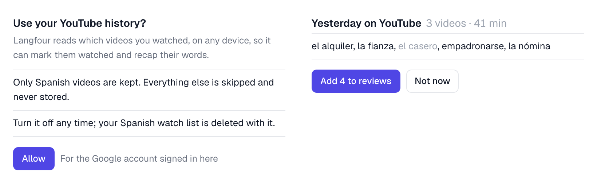

*Left: the per-account approval. Right: the recap of phone watching, on the Practice page and in
the extension popup the next day.*

The recap has to be simple and fast: one glance, at most one tap, never a chore.

- One line on what was watched, the new words in a single comma-separated row, and one button that
  adds them all. Tapping a word drops it. No per-word Keep/Skip, no questions about learning words.
- Learning words that came up need no decision: they count as exposure, like caption words on
  desktop.
- Only words that came up in at least two of the videos, or three times or more, up to 8. With
  none, there is no recap.
- Ignoring it is fine. It is replaced the next day, and nothing piles up.
- Added words go to reviews (or RemNote) with a line from the video as context.

- 70% played on desktop marks a video watched; the Videos page's "Hide & mark as seen" goes.
- A `watch_events` table: learner, video, watched at, share played when known, source. Own rows
  only, like `user_media`. It replaces `videos_seen`, whose rows were mostly dismissals rather
  than watching, so they aren't carried over (built in PR 123).
- What it enables: watched marks, feed seeds and "favourite this channel?" suggestions, word recaps
  and next-video suggestions for phone watching, and "heard" evidence for feature 1.

## 3. Fit badges on every thumbnail

*Find · M · needs 1*

From a thumbnail you can't tell whether you'll follow a video, so people click, struggle for two
minutes and leave. Badges answer that before the click, everywhere on YouTube.

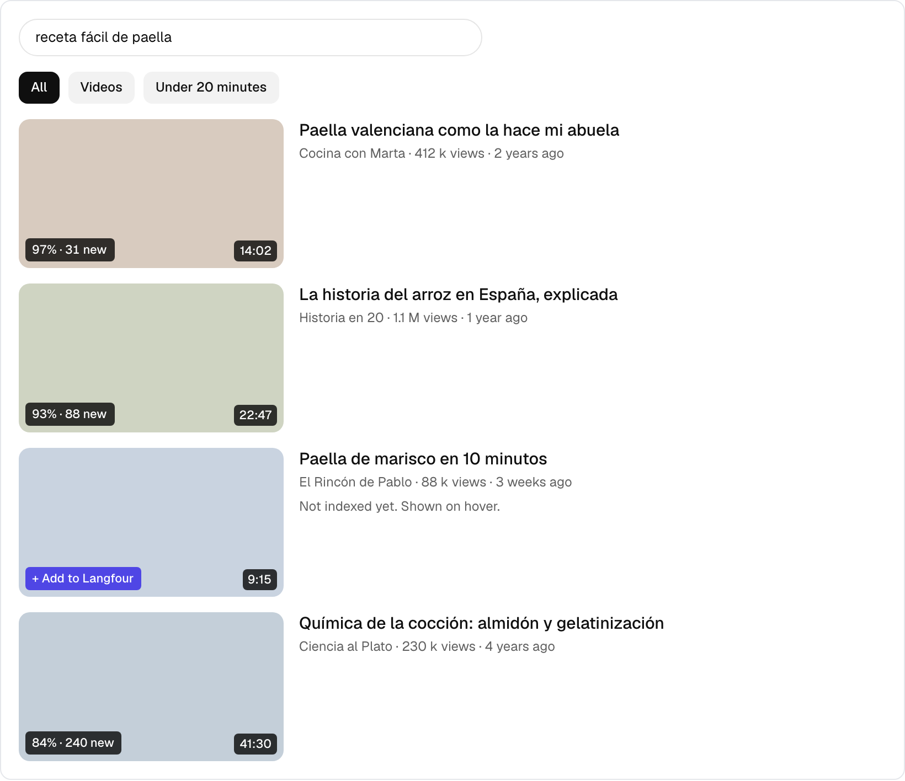

*A badge holds one short value, the heard coverage; hovering it adds the number of new words.
Unindexed videos show "+ Add" on hover. For now there are no bands and no "too easy" state: the
higher the number, the more you'll understand, and every list sorts highest first. Bands can come back once completion data shows
where people actually give up.*

- A content-script observer collects video ids from Home, Search, channel pages and the watch-page
  sidebar as they render. One batched call, `POST /api/videos/fit` with up to 50 ids, returns
  coverage and, for the hover, new words; each id is one sparse row times the known-words vector.
- Cached per learner for 12 hours. Selectors live in one module with a daily smoke test against
  youtube.com, since YouTube's markup changes often.
- Editing youtube.com goes against the spirit of YouTube's terms, as many learning extensions do;
  accepted.

## 4. Favourite channels

*Find · L · needs the existing queue*

Learners scroll through recommendations until they find a few channels where they understand the
speaker and like the topics. Those channels carry them for months. Today that discovery is luck,
it stays private, and Langfour has indexed a median of 10 videos per channel.

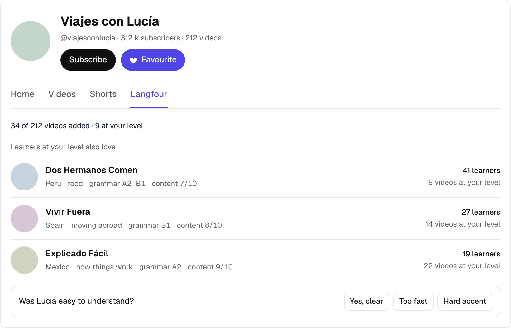

*"Favourite" sits next to Subscribe and replaces the broken Bookmark button. The channel's
Langfour tab lists channels that learners at your level also favourited. The one-tap question
appears after a learner's first few videos from a channel.*

The button is a plain toggle: outline when off, filled when on, like today's Bookmark button.
Indexing progress is shown, but not on the button. The queue will be processed on the server, so a
favourited channel's videos arrive within hours, and the progress is real feedback that the
favourite did something. It lives on the channel's Langfour tab, phrased as what the learner gets:
"34 of 212 videos added · 9 at your level". The line updates as videos land and disappears
once the channel is done. If a channel stalls (no captions, failed downloads), the line drops the
total rather than showing a number that never moves: "34 videos added".

What a favourite does:

- **For you:** the channel gets the biggest share of your feed (5).
- **For other learners:** favourites add up per channel and level band. "Learners at your level
  also love" lists channels favourited by people who favourited this one, at a similar vocabulary
  size.
- **For the index:** no new system. `video_queue` already drains by `priority`, then `score`. A
  favourite raises the channel's pending rows to the user tier (10), adds its unqueued uploads at
  that tier, and lifts the 15-per-channel cap for that channel.

How a channel is described:

- **From scores every video already has.** `video_scores` holds Jev's rubric for all 11,372 scored
  Spanish videos (`video_quality.py`): A, the grammar level (A1–C1); C, content in the words; D,
  developed thought; E, transferable language. A channel's profile is the median of its videos, so
  it covers the whole corpus with no backfill.
- **Not pace.** Speaking rate isn't shown. Transcripts ingested since GitHub PR #111 keep their timings
  (`cues` and `cueSource` in the processed JSON: a caption track's own cues, or Whisper's 15–28 s
  pieces), which moment cards need for clip times and which could give pace later.
- **From learners:** "Yes, clear / Too fast / Hard accent", asked after a learner's first few
  videos from a channel. The only signal on pronunciation and accent.
- **Country:** from `channels.list` (1 quota unit).

**Measure:** share of learners with at least one favourite after two weeks, and how much of their
watching comes from favourites.

## 5. Your feed: a queue per learner

*Find · L · needs 1; 2 and 4 make it personal*

Everyone draws from one global list sorted by the grey number, which surfaces trivial clips. Each
learner should have their own queue, built ahead of time, leaning towards the channels and topics
they like.

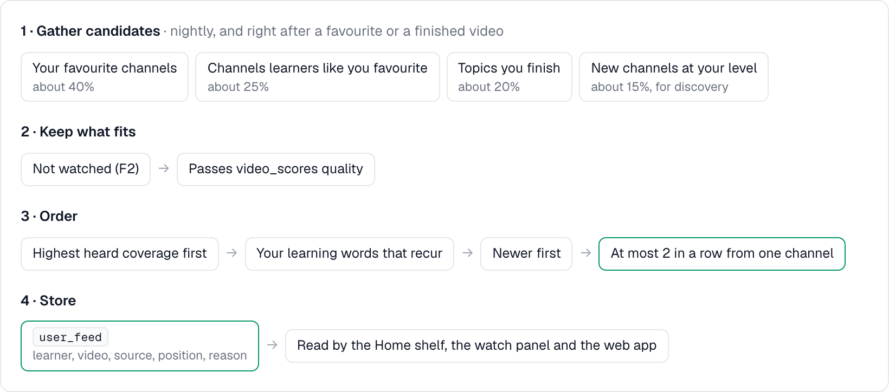

*Until a learner has favourites and watch history, the current recommender (with coverage on words
heard) fills the whole feed, and it stays the fallback for any source that runs dry. The shares are
starting values to tune; the mix keeps some discovery even for learners with strong favourites.*

- Rebuilt nightly, and right after a favourite or a finished video.
- Stored in `user_feed` (learner, video, source, position, reason), so the Home shelf, the watch
  panel and the web app read a ready list instead of scoring 11,000 videos per request.

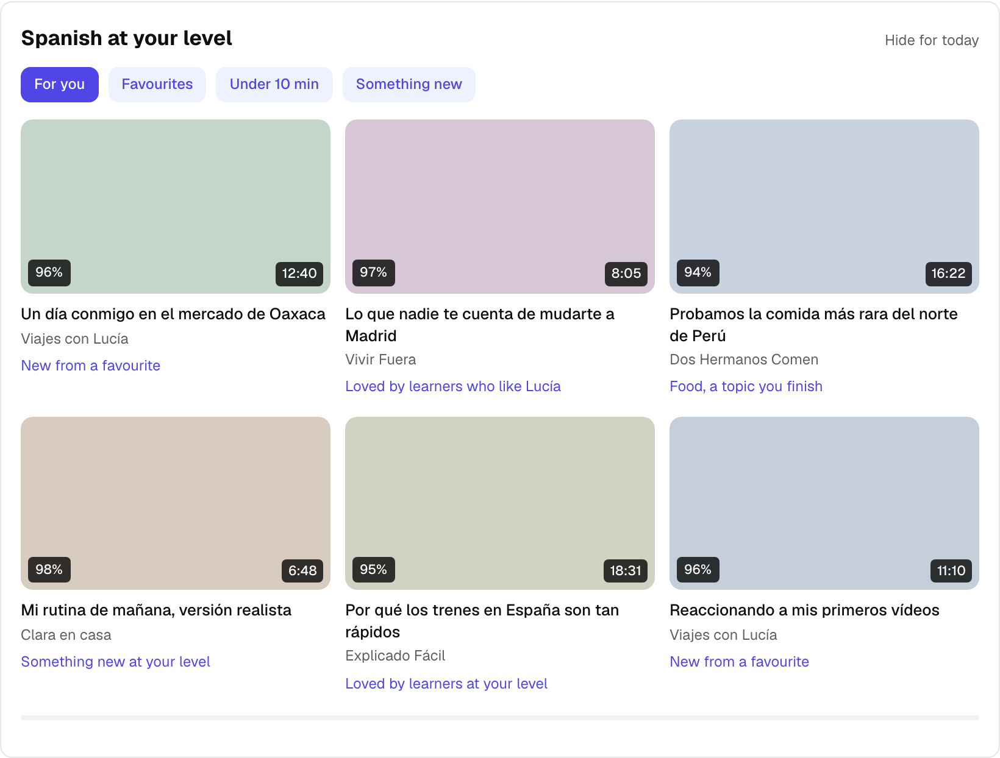

*The main surface: a shelf at the top of youtube.com Home. Each card says which source put it
there.*

## 6. Steer YouTube's own recommendations

*Find · M · needs 2 for the history, 3 for language labels*

On a phone, YouTube's own Home and Up next decide what people watch. If half an account's history
is English, half its feed is too. YouTube's recommendations follow the account's history,
subscriptions and "Not interested" feedback, and the learner controls all three.

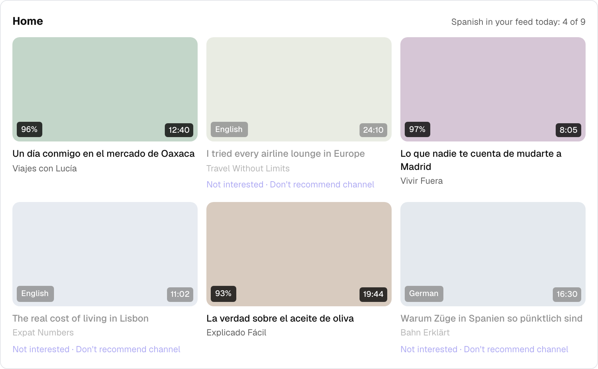

*Videos in other languages get a plain language label and YouTube's own two feedback buttons one
tap away. The count at the top shows whether the feed is turning Spanish.*

The levers, strongest first:

1. **A learning profile.** A second Google account or a YouTube Brand account used only for Spanish
   and signed in on the phone. The cleanest feed with no tooling; onboarding suggests it.
2. **History cleanup.** With feature 2's history, list recent videos that aren't in the learning
   language. The learner reviews and confirms; the extension removes them through YouTube's own
   "Remove from watch history".
3. **Feedback on Home:** language labels and one-tap "Not interested" or "Don't recommend channel".
4. **Favourite also subscribes,** as an option, since subscriptions weigh heavily.
5. **Settings checklist:** YouTube location set to Spain or Mexico; pause history while watching in
   other languages.

Not this: playing videos in the background to add fake watches. It inflates creators' view counts,
YouTube treats it as fake engagement, and it puts the learner's account at risk.

**Measure:** share of Spanish videos on the learner's Home feed, counted on desktop where the badges
already classify every card.

## 7. A watch panel built for flow

*Watch and keep · M · needs 5*

Learners came to watch. Every stop costs momentum, so the panel keeps the video playing and lines
up the next one rather than adding study tools.

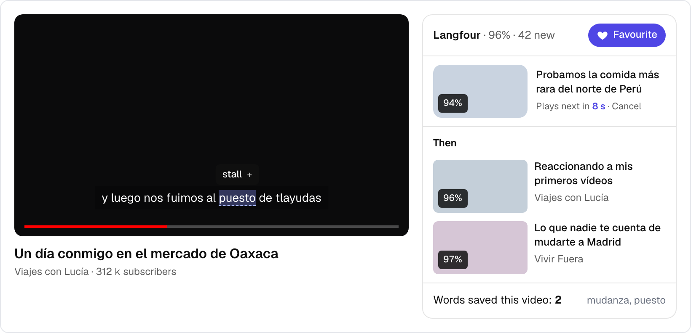

*Hovering a caption word shows its meaning with the + while the video keeps playing. When the video
ends, the next one from the feed starts after a short countdown, in place of YouTube's autoplay
pick. Nothing is drawn over the player beyond today's caption marking.*

- **Look up without stopping:** a short hover shows the translation and the + in place. A click
  opens today's full popup and pauses, as now.
- **Our autoplay:** on `ended`, the panel starts the next feed video after 8 seconds; it can be
  turned off.
- **Up next from the feed** replaces YouTube's list in the panel. Collapsible, and it remembers.
- No transcript, replay, loop or pause tools. A learner who wants study mode has the reader.

**Measure:** videos and minutes per session with the panel on vs off.

## 8. Core words for a channel or a series

*Watch and keep · M · needs 1, 4*

Nobody preps before a single video. But a channel or a series has a vocabulary of its own: a Clash
Royale channel says *cofre* and *desbloquear* in every video. Learn those once and the whole
channel opens up.

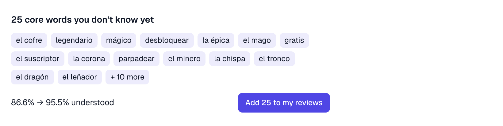

*Real numbers: a learner with 2,449 known words and the 13 indexed videos from BasiCH, who would
understand 86.6% of the channel's speech now and 95.5% after the 25 words. Shown on the channel's
Langfour tab after a favourite, under the progress line, and on a series page in the Library.*

- Core words: unknown words that appear in at least half of a channel's (or series') videos,
  ordered by how often they're spoken, up to 25.
- It pays off for channels with a narrow topic. Across channels with 12 or more videos, the typical
  gain from 25 words was about 2 points of heard coverage, against 9 for BasiCH and a beading
  channel. The card only appears when the gain is real, for example 3 points or more.
- "Add to my reviews" goes to Langfour's scheduler or RemNote, with a line from the channel as
  context.
- Netflix and Prime series work the same way from the Library's episodes, which carry series and
  season.

## Build order

Five PRs cover features 1–4 and 8.

| PR | Contents | Needs |
|---|---|---|
| 1 · Coverage counts every word | `int16` count matrix, a binary view for distinct new words and words to learn, a `"weights": "counts"` marker that old matrix files fail, tests, corpus repack. One fit function that 4 and 5 call. | nothing |
| 2 · Stuck common words | A "Common words you never reviewed" tab on the Learning table with the dark pill, a one-time link in the popup, learning-account advice in onboarding, and the `como`/`vale`/`gracias` re-root fix. | nothing |
| 3 · Watch signal + recap | `watch_events` replacing `videos_seen`; watched at 70% played, with unmark; the history-page read after one consent; yesterday's recap. | nothing |
| 4 · Fit badges | `POST /api/videos/fit`; an observer with all selectors in one module; badges with the percentage only; "+ Add" queues the video. | 1, server queue |
| 5 · Favourite channels + core words | `channel_favourites`, Favourite replacing Bookmark, the queue bump and lifted cap, and the Langfour tab with the progress line and core words. | 1, server queue |

PR 1 goes first because every later screen shows its numbers. PRs 2 and 3 don't read the matrix
and touch other files, so they can run alongside it. PRs 4 and 5 wait for the server queue
(`feat/backend-ingest-worker`), so "+ Add" and Favourite lead to indexed videos within hours.

After these: the per-learner feed and Home shelf (feature 5), steering YouTube's feed (6), the
watch panel (7), and, once there are more learners, "Learners at your level also love" and the
clarity question.

## Later

- **Index ahead of demand.** Store each video's word counts in Supabase (`video_terms`) so a new
  video is recommendable within a minute instead of after a repack, upload and restart. Then let
  demand (favourites, feed appearances, opens) set queue priority continuously. Until then,
  favourites bumping the existing queue covers the main case.
- **Moment cards.** A saved word returns in review with the 4-second clip it came from, in YouTube's
  embedded player. Only made when Jev judges the moment a good fit: the word in its common meaning,
  a line that stands on its own, short, clean caption timing. Otherwise a plain card.
- **A video graph.** "More like this, 2–3 steps out" needs a feasibility study first. The Data API's
  related-video search was removed in 2023 (to verify); featured channels (`channelSections.list`,
  1 unit) are allowed and cheap; the learner's own sidebar is the best signal but a grey zone;
  calling YouTube's internal endpoints from our servers is out. Co-favourites (4) and co-watching
  (2) can be built regardless.
